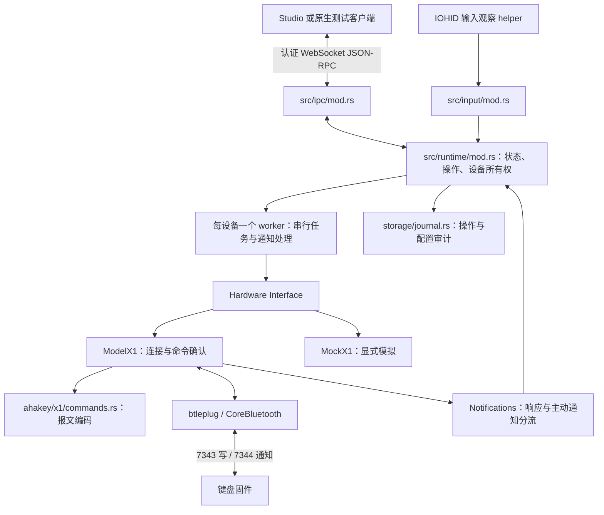

# AhaKey X1 蓝牙通信与 Runtime 联调手册

核对日期：2026-09-29。面向固件、Rust Runtime、Studio 和第三方联调人员。
本文描述当前本地源码实现，不代表连接中的实物已经运行相同固件。

## 1. 先分清三种“地址”

| 名称 | 当前值或形式 | 用途 |
| --- | --- | --- |
| Runtime 设备 ID | `x1-<平台外设ID>`；macOS 下后半部分为 UUID | `--device-id`、IPC 的 `deviceId` |
| BLE GATT UUID | 服务 `7340`、命令 `7343`、通知 `7344` | 定位设备配置通信通道 |
| 本机 IPC 地址 | `ws://127.0.0.1:<动态端口>/` | Studio/脚本连接 Rust Runtime |

设备 ID 不是 GATT UUID，也不是本机 WebSocket 地址。当前 macOS 后端使用
CoreBluetooth 的外设 UUID，不接受把蓝牙 MAC 地址直接当作 `--device-id`。
不要把其他电脑上的外设 ID 或上次启动的 IPC 端口写死在客户端里。

运行 Runtime 后，从 `Found X1: x1-... (设备名称)` 获取实际设备 ID。
本手册不写入某一台机器的 ID、token 或随机端口。

### GATT 地址表

UUID 的完整形式为 `0000xxxx-0000-1000-8000-00805f9b34fb`。
方向以电脑为参照，特征属性以当前固件 `Profile/gattprofile.c` 为准。

| 用途 | 完整 UUID | 属性 | 当前 Runtime 使用情况 |
| --- | --- | --- | --- |
| 配置服务 | `00007340-0000-1000-8000-00805f9b34fb` | Service | 扫描过滤、服务匹配 |
| 批量数据通道 | `00007341-0000-1000-8000-00805f9b34fb` | Read / Write | 未使用；固件写回调进入 `receive_data` |
| 设备信息 | `00007342-0000-1000-8000-00805f9b34fb` | Read | 未使用，不代替能力查询 |
| 命令：电脑 → 键盘 | `00007343-0000-1000-8000-00805f9b34fb` | Write | 使用 `WriteType::WithResponse` |
| 响应/事件：键盘 → 电脑 | `00007344-0000-1000-8000-00805f9b34fb` | Notify | 必须先订阅，再发命令 |
| 预留读取特征 | `00007345-0000-1000-8000-00805f9b34fb` | Read | 未使用 |

无需硬编码 ATT handle；连接后按服务 UUID 和特征 UUID 查找。不要把 `7341`
的数据上传通道当作 `7343` 的命令通道。操作系统接收普通键盘按键的 HID 路径与
这个配置服务分开，`7344` 的通知不是通用的物理按键事件流。

### IPC 地址的发现

macOS 默认文件：`~/Library/Application Support/AhaKey/runtime/discovery.json`。
内容包含 `endpoint` 和 `token`。只查看地址、不输出 token：

```sh
python3 - <<'PY'
import json, os
from pathlib import Path
path = Path(os.environ.get('AHAKEY_RUNTIME_DISCOVERY',
    str(Path.home() / 'Library/Application Support/AhaKey/runtime/discovery.json')))
print(json.loads(path.read_text())['endpoint'])
PY
```

`--discovery ABSOLUTE_PATH` 或 `AHAKEY_RUNTIME_DISCOVERY` 可覆盖默认位置，
命令行优先；双方必须使用同一个文件。目录权限 `0700`，文件 `0600`。
文件中的 token 用于 `runtime.hello`，不能放进 URL 或联调日志。
默认只监听 IPv4 回环地址，拒绝携带 Origin 的浏览器连接；使用原生客户端。

## 2. 源码版本与支持范围

本次固件依据为远端 [Fireware-harness `076382b`](https://github.com/AhakeyAI/AhaKey-X1-hardware-source/tree/076382b2214289ac7bc1735d669d7de78730c4da)；生产源码与已验收的 `70ca334` 相同。
设备以 `0x9F` catalog 标识，不能从分支名或本地源码判断实物已运行相同构建。

| 功能 | 固件协议 | 当前 Rust Runtime |
| --- | --- | --- |
| 完整状态、模式通知 | `00`、`9B` | 查询状态并接收推送，不轮询 |
| 配置写入和保存 | `73/84/85/04` | 串行确认，亮度回读验证 |
| 身份 | `9F` catalog | 匹配 catalog，再验证查询结构 |
| 按键动作和描述 | `87 mode key` | 连接、重连、重启自动读回 |
| 亮度和灯效 | `88 00`、`88 01 mode state` | 自动读回并投影到 configuration.get |
| OLED 图片资源 | `88` 元数据、`8A/B/C` 上传 | 已接入查询、上传、暂停与继续 |
| 灯效预览、资源清除 | `89`、`8D` | 尚无应用接口 |
| 模式、休眠、语音引导、拨杆 | `92/95/96/97` | 尚无对应配置接口；`96` 是语音引导 |
| AI 呈现 | `90/98/99/9A` | 尚无对应应用接口；`98` 只设置 |

`configuration.get` 返回 Runtime 已读到的设备数据，自身不触发 BLE 查询。
动作、描述及其他现有可写字段完整可读且可表示时，自动生成完整 configuration；不可读字段保留未知。
读取的是设备保存的配置，实际物理键输出仍需结合该构建的按键处理路径验收。

## 3. 内部架构与数据流



源码入口：

| 文件 | 职责及联调修改位置 |
| --- | --- |
| [app/mod.rs](../src/app/mod.rs) / [options.rs](../src/app/options.rs) | CLI、调试开关、IPC 启动与退出 |
| [protocol/ble.rs](../src/protocol/ble.rs) | 服务过滤、名称匹配、选择设备 |
| [ahakey/hardware.rs](../src/ahakey/hardware.rs) | 型号间共享的 Hardware Interface |
| [ahakey/x1/connection.rs](../src/ahakey/x1/connection.rs) | GATT 会话、超时、串行 exchange |
| [ahakey/x1/adapter.rs](../src/ahakey/x1/adapter.rs) | Hardware 实现、配置读回入口、写入与亮度确认 |
| [ahakey/x1/notifications.rs](../src/ahakey/x1/notifications.rs) | 通知过滤、ACK 等待、状态推送与断线 |
| [ahakey/x1/state.rs](../src/ahakey/x1/state.rs) | X1 状态帧字节偏移与字段有效性 |
| [ahakey/x1/commands.rs](../src/ahakey/x1/commands.rs) | 组帧、动作、灯光与保存命令编码 |
| [configuration/mod.rs](../src/configuration/mod.rs) / [configuration/keymap.rs](../src/configuration/keymap.rs) | 输入参数范围、角色/索引映射 |
| [runtime/worker.rs](../src/runtime/worker.rs) / [operations.rs](../src/runtime/operations.rs) | 设备串行循环、并发预留、操作受理与恢复 |
| [runtime/state.rs](../src/runtime/state.rs) / [device.rs](../src/runtime/device.rs) | 快照、输入、设备状态与基线失效 |
| [ipc/session.rs](../src/ipc/session.rs) / [client.rs](../src/ipc/client.rs) / [wire.rs](../src/wire.rs) | 消息收发、认证、订阅、可用方法与对外字段 |
| [debug.rs](../src/debug.rs) | 可关闭的 JSONL 日志，后台限量队列 |

固件侧调用链：`Profile/hiddev.c::simpleProfileChangeCB` → `receive_bytes`
→ 命令任务 → `command_process` → `command_return_frame` → `peripheralChar4Notify`。
报文处理位于 `APP/sub_main/command_solve.c`，UUID/属性位于
`Profile/include/gattprofile.h` 和 `Profile/gattprofile.c`。

### 连接与并发约定

1. 按服务 `7340` 查询已知外设并扫描，名称忽略大小写后须以 `ahakey` 或 `vibe code` 开头。
2. 自动选择后，本次进程固定使用该设备；`--device-id` 可精确指定。
3. macOS 每次连接前按外设 UUID 重新 retrieve，避免使用已失效的 Peripheral。
4. 连接、发现特征、建立通知流、订阅 `7344`，然后向 `7343` 发 `00` 状态查询。
5. 状态解析成功即可 ready；ready 表示配置通信就绪，不等于 HID 键盘已可输入。
6. 每设备只有一个 worker 和一个在途命令。等待 ACK 时同一通知消费者继续记录状态。
7. 无命令时等待通知，不因设备安静而超时。模式通知不是由 Frontend 轮询获得。

一个 Runtime 为唯一 BLE owner。多个测试客户端应通过 IPC 接入，不能各自另开
BLE 连接。不同 discovery 路径的进程锁不能阻止两个实例争抢同一实物。

## 4. 报文格式与确认规则

本文 hex 中每个两位数表示一个字节，数字范围未标 hex 时为十进制。

```text
请求：    AA BB <opcode> <payload...> CC DD
普通 ACK：AA BB <opcode> <status> CC DD
```

没有事务 ID、长度字段或 CRC。`00` 状态回复是例外，opcode 后直接跟电量，
不能把电量误当 status。扩展查询通常在 status 后继续带数据。

Rust 当前先筛选 service=`7340`、characteristic=`7344`，再重组完整帧并按以下规则处理：

- opcode=`00`：必须通过状态解析才完成状态查询。
- 其他请求：opcode 匹配、status=`00` 后交给具体协议解码器校验长度、地址和字段。
- 除 `87` 的精确六字节 status 2/3 留给读回处理外，非零 status 映射为 `DEVICE_REJECTED`；原始码见 `ble.rx`。
- 同一 opcode 没有请求 ID；迟到回复可能混淆下一次请求，因此失败会断开旧会话。
- GATT 写入成功和设备协议成功是两层确认。ACK 成功也不等于已验证业务效果。

通用状态常量为 `00` 成功、`01` 参数格式错误、`02` 越界、`03` 数据过长；各命令仍需按具体协议解释。不能只看 status=0 判断支持，应校验结构化回复。

### MTU、分片与帧边界

当前 `Fireware-harness` 固件的 `peripheralChar4Notify()` 会按 `peripheralMTU - 3` 顺序发送多个通知。
默认 MTU=23 时，每个通知最多 20 字节；catalog 和最长 64 字节的按键回复会跨多个通知。

Runtime 在每个 BLE 会话内拼接 `7344` 通知；帧头、帧尾可以跨通知，也可连续处理多帧。
`87` 按动作和描述长度确定边界，`88` 按查询类型确定长度，`97` 按各档位动作长度确定边界，
因此二进制内容中的 `AA BB` / `CC DD` 不会被误判为帧边界。catalog 文本和状态/ACK 按帧尾识别。
取消等待保留当前片段；断线或解析错误清空缓存。未完成帧最多 255 字节，对应固件回复长度字段上限。

`ble.rx` 记录各个原始通知，`ble.frame` 记录拼接后的完整帧。小 MTU 真机联调应核对 catalog、
长按键读回以及重连后的 `configuration.get`，同时确认模式推送和命令 ACK 正常。

本次仅处理回复重组；命令发送仍使用平台的 GATT `WithResponse` 写入。
长宏、描述和图片分块的发送仍需验证平台长写入和实际 MTU。

## 5. 已接入命令及参数

| opcode | payload（不含 opcode） | 当前用途 |
| --- | --- | --- |
| `00` | 空 | 查询完整状态 |
| `04` | 空 | 保存键位/灯光配置 |
| `73` | `<subtype> <mode> <index> <data...>` | `73` 快捷键、`74` 宏、`75` 描述 |
| `84` | `<mode> <9个effect字节>` | 模式内 AI 状态灯效表 |
| `85` | `<brightness>` | 亮度 1..100；ACK 后 Runtime 再发 `00` 确认 |
| `9B` 通知 | `<00> <mode> <source> <sequence>` | 仅接收；更新当前模式 |

模式 `mode=0..3`；按键 `index=0..3`。Studio 显示的模式 1..4 需减一。
完整配置角色依次对应：`0=voice`、`1=approve`、`2=reject`、`3=submit`。
角色标签不保证某个固件分支对物理键采用相同行为。

快捷键 data 为 HID usage 列表：`control=E0`、`shift=E1`、`alt=E2`、
`gui=E3`，随后可带一个普通 keyCode；keyCode=0 时不附加普通键。
DFJK 的 usage 是 `07 09 0D 0E`，不是 ASCII 字符编码。

宏每步两字节：`00 00` 无操作、`01 <usage>` 按下、`02 <usage>` 松开、
`03 <ticks>` 延时、`04 00` 全释放。ticks=delayMs/3；Runtime 限制 1..49 步、
delayMs=0..765 且为 3 的倍数。描述最多 20 字节 ASCII。

灯效表的九个状态顺序固定：
`notification, permissionRequest, postToolUse, preToolUse, sessionStart, stop,
taskCompleted, userPromptSubmit, sessionEnd`。

effect 编号按固件顺序，不能照 UI 菜单顺序编号：

| 编号 | effect | 编号 | effect |
| --- | --- | --- | --- |
| 0 | off | 9 | scanBar |
| 1 | singleMove | 10 | pulseCenter |
| 2 | rainbowMove | 11 | warningBlink |
| 3 | rainbowWave | 12 | successSweep |
| 4 | rainbowWaveSlow | 13 | blueThinking |
| 5 | breathing | 14 | lowBattery |
| 6 | middleLight | 15 | chargingFlow |
| 7 | typingRipple | 16 | approvalWait |
| 8 | comet | — | — |

### `00` 状态字段：绝对字节偏移

当前新固件回复 13 字节，例如：

```text
TX: AA BB 00 CC DD
RX: AA BB 00 5C 32 01 00 02 00 01 23 CC DD
```

| 偏移 | 字段 | 示例 | 当前 Runtime 处理 |
| --- | --- | --- | --- |
| 0..1 | 帧头 | AA BB | 校验 |
| 2 | opcode | 00 | 校验 |
| 3 | 电量 | 5C=92% | 0..100 有效，否则 null |
| 4 | 信号字段 | 32=50 | 不投影；固件目前写常量，不当实测 RSSI |
| 5..6 | 固件版本常量 | 01 00 | 不投影；`9F` 返回 catalog |
| 7 | 当前模式 | 02=模式索引2 | 0..3；越界则整帧无效 |
| 8 | 当前灯效 | 00 | HardwareState 保留，Device DTO 未暴露 |
| 9 | 拨杆 | 01 | 0→automatic，1→manual，其余→null |
| 10 | 亮度 | 23=35 | 有该扩展字段且 1..100 时有效 |
| 11..12 | 帧尾 | CC DD | 校验 |

该构建没有追加连接 flags，不能把帧尾当作连接状态。

### `9B` 模式推送

```text
AA BB 9B 00 02 01 07 CC DD
```

表示模式索引2、来源键盘、sequence=7。source：0 查询、1 键盘、2 主机。
Runtime 要求总长9、status=0、mode<4、source<=2，且已有初始状态，才更新模式。
sequence 为单字节，可从255回到0；不能按无限递增数字比较。当前 Runtime 按到达
顺序处理，不用 sequence 去重，也不做缺帧补查。

## 6. 固件扩展与 Runtime 自动读回

以下查询复用同一个设备 worker 和通知消费者，应用使用 `configuration.get` 获取读回结果。

### `9F` catalog 查询

```text
TX: AA BB 9F CC DD
RX: AA BB 9F 00 <ASCII catalog> CC DD
catalog: x1-c582-hw1-p1-1.0.0-r001
```

catalog 相同仍需结构化查询回复确认支持。未知 catalog 不尝试配置读回。
通用成功 ACK 不作为功能支持证据；查询超时/拒绝后关闭旧会话。

### `87` 按键动作与描述

```text
TX: AA BB 87 <mode> <key> CC DD
RX: AA BB 87 00 <mode> <key> <type> <actionLen> <action...> <descLen> <desc...> CC DD
```

mode/key 均为 0..3；type 为 00 未分配、73 快捷键、74 宏。
响应最多 64 字节，描述最多 20 字节，尾部空格/零字节由固件裁去。
状态 2/3 的六字节错误回复没有地址回显：2 表示越界或保存类型不支持，3 表示响应过长。
Runtime 每次只保留一个有效请求，记录该键状态并继续读取其他键。

### `88` 亮度、灯效和资源元数据

```text
TX: AA BB 88 00 CC DD
RX: AA BB 88 00 00 <brightness> CC DD
TX: AA BB 88 01 <mode> <state> CC DD
RX: AA BB 88 00 01 <mode> <state> <effect> CC DD
```

state=0..8，effect=0..16；资源元数据使用 selector 2/3，见 [OLED API](oled-api.md)。
每次完整配置采集为 53 个请求，稳定路径共 107 次交换（含一次 catalog 查询）。
连续两次原始观察值一致才发布，最多三次、总预算 45 秒，不含前后状态刷新。
可表示的完整读回成为本次会话基线；不可表示动作、非 ASCII 描述和失败状态保留未知及原始数据。
`taskLightMode` 为 null，不发送不存在的 `98` 查询。读回不写设备，读取当前 RAM 不代表已验证断电保存。

### 尚未开放给应用的命令

`92` 模式、`95` 休眠、`96` 语音引导、`97` 拨杆、`98/99/9A` AI 呈现需各自应用接口。
`98` 为设置命令，`99` 使用该构建的带版本四槽完整快照，`9A` 不提供旧式任务状态查询。
固件已有命令不等于 Runtime 已开放对应 WebSocket 方法。

## 7. 从 IPC 联调参数

调用顺序：读取 discovery → WebSocket → `runtime.hello` → `runtime.subscribe`
→ 根据快照取 deviceId → `configuration.get` → 必要时显式修改 → 等待 operation终态。

认证示例（占位符须在客户端内替换，不要把真实 token 写入文档）：

```json
{"jsonrpc":"2.0","id":"hello-1","method":"runtime.hello","params":{"protocol":{"major":1,"minor":0},"client":{"name":"firmware-debugger","version":"1","kind":"cli"},"token":"TOKEN_FROM_DISCOVERY"}}
```

```json
{"jsonrpc":"2.0","id":"subscribe-1","method":"runtime.subscribe","params":{"topics":["state"],"cursor":null}}
```

| IPC 方法 | 用法/重要区别 |
| --- | --- |
| `configuration.get` | `{deviceId}`，取得 baseToken 和已知配置；不是 BLE 读回 |
| `keymap.apply` | `{operationId,deviceId,baseToken,mode,keys}`，替换1..4个指定键并保存 |
| `configuration.apply` | 完整校验的所选模式 + 全局亮度，要求可信完整基线 |
| `operation.get` | `{operationId}` 查询受理、进度与终态 |
| `device.connect` / `device.disconnect` | `{deviceId}`，控制进入同一设备队列 |

详细按键 JSON 见 [keymap-api.md](keymap-api.md)。两种 apply 都是持久配置写入，
不是退出软件恢复的临时模式。`keymap.apply` 即使完整配置为 null 也可用，但仍需要
当前 baseToken；仅仅联调状态不必先初始化设备。

编码顺序：完整配置先亮度（再状态确认），各键先清互斥层再写动作/描述，各模式灯效，
最后 `04`。独立 keymap 只对列出的键清互斥层、写动作，最后 `04`。
模式0/键1写 F 的 Runtime 命令组示例（会修改配置）：

```text
AA BB 73 74 00 01 CC DD       清该位置原宏层
AA BB 73 73 00 01 09 CC DD    写 F
AA BB 04 CC DD                保存
```

每个命令分别等待同 opcode ACK。`accepted` 只表示已入队和记录，不代表完成。
completed 表示全部达到现有确认规则；仍要实测按键输出和断电持久性。
失败可能部分生效，不能凭超时认定没写入。同 operationId 同内容幂等；断线后优先
查询旧 ID，不能盲目生成新 ID 重试。重新连接会使 baseToken 和配置基线失效。

## 8. 可调参数、超时与日志

| 参数/常量 | 当前值 | 修改入口 |
| --- | --- | --- |
| 主动扫描等待 | 3秒 | `protocol/ble.rs::find_x1` |
| 未发现设备后重试 | 10秒 | `protocol/ble.rs::discover` |
| 断连后连接重试 tick | 3秒 | `runtime/worker.rs` |
| GATT连接建立超时 | 15秒 | `ModelX1::connect` |
| 自动读回总上限 | 45秒；最多采集3次 | `ModelX1::read_configuration` |
| 单命令写入+响应总超时 | 4秒 | `ModelX1::exchange` |
| 断开超时 | 3秒 | `ModelX1::disconnect` |
| 已确认配置命令后间隔 | 50毫秒 | `ModelX1::write_confirmed` |
| IPC握手/认证超时 | 各10秒 | `ipc/session.rs` |
| IPC发送超时 | 5秒 | `ipc/session.rs` |
| 正常退出等待在途写入 | 最多30秒 | `main.rs` |

这些时间目前是源码常量，不是可用 CLI 参数；不要假设存在 `--timeout`。
需要测链路延迟时看 `ble.exchange.durationMs`；50ms间隔不包含在单次exchange里。
IPC探针测到的本地往返时间也不是物理按键到系统的延迟。

常用启动选项：`--debug`、`--debug-log NEW_FILE`、`--device-id ID`、
`--discovery ABSOLUTE_PATH`、`--mock`。`--initialize FILE` 是显式覆盖配置，
不是只读调试开关。输入观察 helper 另用 `--input-monitor`，需要独立的输入监控授权。

新一轮联调建议：

```sh
# 在 Rust 仓库中运行；先停止旧 Runtime/旧 BLE owner
cargo run --locked -- --debug-log "/tmp/ahakey-debug-$(date +%Y%m%d-%H%M%S).jsonl"
```

从日志取得 ID 后，可用只读探针检查正在运行的 Runtime：

```sh
python3 scripts/diagnostics/check-device.py 'x1-REPLACE_WITH_ID'
```

需要测试重连才添加 `--reconnect`。探针依赖相邻 Studio 仓库和 macOS Swift，
可用 `--studio PATH` 改路径。独立改键客户端支持预览，CLI 模式使用 Studio 的1..4：

```sh
cargo run --locked --example runtime-keymap -- --device-id 'x1-REPLACE_WITH_ID' --mode 1 --keys dfjk
```

默认不写入；`--apply` 才会保存。当前 Voice Key 固定 F18 的限制仍然适用。

核心日志：`ble.tx`→`ble.rx`→`ble.frame`→`ble.exchange`→`device.state` 或 `operation.changed`。
日志的数字字段 opcode 是十进制，`frame.hex` 才是十六进制。未知通知、无效帧也会
留在 `ble.rx`，不等于 Runtime 支持其业务含义。详见 [debug-mode.md](debug-mode.md)。

## 9. 联调故障速查与交接记录

| 现象 | 优先检查 |
| --- | --- |
| 扫不到设备 | 蓝牙授权、广告中的7340服务、名称前缀、是否选错deviceId |
| IPC已连上但无设备 | IPC服务和BLE发现独立；看 `ble.discovery/notFound` |
| 有GATT写成功但4秒超时 | 7344是否订阅、响应opcode/首尾、长度、MTU；看exchange.phase |
| 大查询超时但00正常 | 对照 ble.rx 各分片与 ble.frame 完整帧，检查是否缺片、长度不符或固件未回复 |
| 模式/拨杆不更新 | 是否真的发00/9B、9B是否9字节、mode/source是否合法 |
| 非零ACK变成DEVICE_REJECTED | 从ble.rx读取原始status，不能只看统一Runtime错误码 |
| configuration仍为null | 检查readStatus、不可表示的动作/描述及亮度范围；完整可读数据会自动建立基线 |
| 改Voice键ACK成功但仍F18 | 检查raw-F18固件分支的固定索引0逻辑 |
| 接口返回UNSUPPORTED_CAPABILITY | 区分未知IPC方法、缺GATT特征、无有效亮度及亮度回读不一致 |
| 超时后结果unknown | 可能已执行部分命令，按operationId核对，不自动重发 |

交接一次联调时记录：固件分支/构建版本、Runtime提交及未提交改动、操作系统、
设备名称和本机deviceId、服务/特征发现结果、操作步骤、请求参数（去掉token）、
operationId、预期与实际结果、同一会话JSONL，以及是否验证断电后结果。
只附日志不附 discovery.json；原始BLE报文可能包含键位描述或自定义数据。

本文仅对照源码，未在本次编写过程中连接设备、写配置或验证新固件真机行为。
