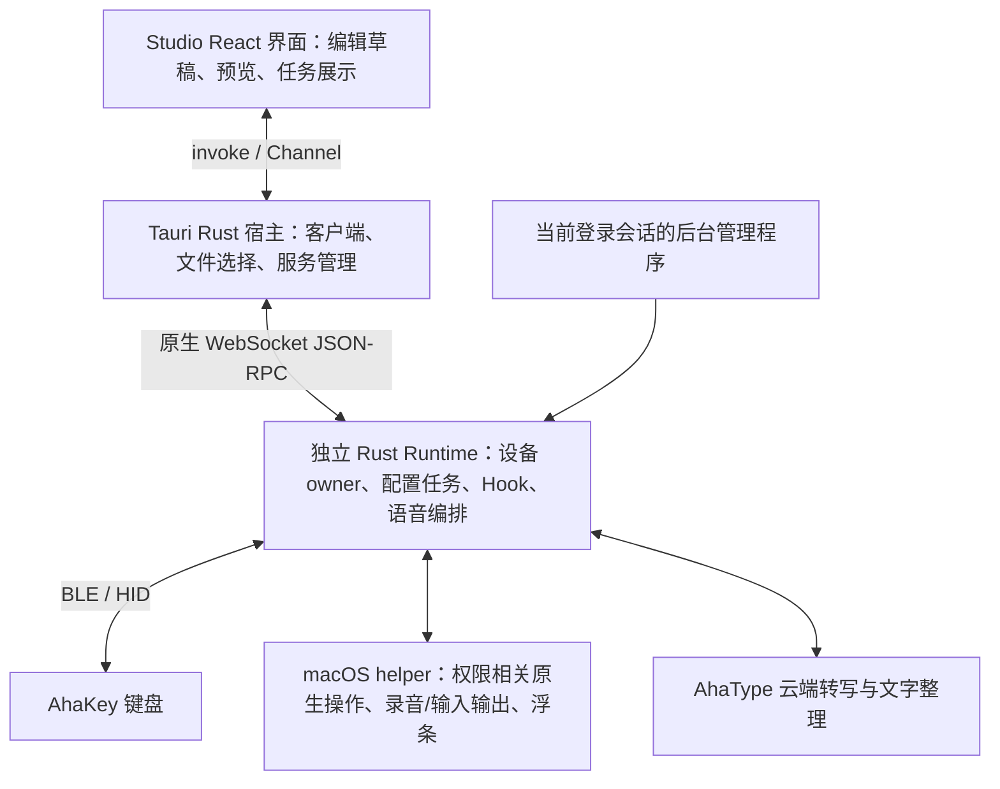

# Runtime 配套 Tauri Studio 调研与实施建议

> 2026-10-23 实施范围更新：用户明确取消旧 macOS Agent。Studio 直接对接 Rust Runtime；旧 Agent 的兼容、迁移、备份、接管、失败回退及共享锁兼容均不再属于交付范围。下文相关内容保留为原参考方案的调研记录，不再作为实施要求。Runtime 自身的单实例与设备所有权机制继续保留。


调研日期：2026-10-22。目标：macOS 优先，使用 Tauri 2 建设 Rust Runtime 的配置、管理和诊断客户端。本文是技术建议；产品行为以 [macOS 整合决策](https://github.com/AhakeyAI/desktop/blob/runtime/docs/macos-runtime-integration-decisions.md) 为准。

## 1. 结论

采用 **React + TypeScript + Tauri 2 薄宿主 + 独立 Rust Runtime + 必要的 macOS 原生 helper**。复用现有 Tauri 前端组件和交互素材，将设备、Hook 和后台语音职责集中到 Runtime。Studio 退出后，Runtime 和语音反馈 helper 继续工作。

推荐在 Desktop 仓库建立独立实施分支，演进 `ahakey-studio-tauri`；保留现有 Windows 发布线，避免直接覆盖其后台行为。Runtime 保持独立仓库和可独立运行能力。`ahakey-sdk` 可以承接后续公开 SDK，但当前本地仓库仅有 README 和 LICENSE，不作为现成客户端依赖。

先交付真实 IPC 的内部版本：启动/发现 Runtime → 订阅 → 读回 → 编辑并保存一个键 → OLED 上传/暂停/继续 → 关闭再打开 Studio 恢复状态。正式 macOS 发布仍须迁齐既有 Mac 功能、后台语音及保留配置升级；内部版本不缩减原定发布范围。

## 2. 本次核对基线

| 对象 | 基线 | 说明 |
| --- | --- | --- |
| 产品决定 | Desktop `runtime` 分支决策文档，blob `3df03f8181454e45811cdcf43c805db3e289ccca` | 2026-10-19 的已确认要求 |
| Desktop main | `1b8882a5c7f546e60a1b868c16edbab46104184f` | 本次 GitHub tree API 核对，重点阅读 Tauri 和 Mac 功能源码 |
| Runtime 本地与远端 main | `0f9561e0d8361a66b11dce6669058264efea5b36` | 已超过决策文档所列的旧 dev 基线，应以当前代码做增量设计 |
| SDK 本地 | `7185466613037c7b9294c997984a0badeb39cfc3` | 仅 README、LICENSE |
| 固件 | 本次不另行宣布新验收基线 | Runtime 文档分别引用 `076382b` 配置读回基线与 `70ca334f` OLED CP2 基线；实施须绑定同一交付镜像、构建配置及哈希 |

Runtime 工作区已有未跟踪 `src/crate/`，本次未修改。没有运行真机、刷写、安装服务或改变后台状态；结论来自文档、源码及现有测试代码阅读。

源码入口：[Desktop 固定提交](https://github.com/AhakeyAI/desktop/tree/1b8882a5c7f546e60a1b868c16edbab46104184f)、[Runtime 固定提交](https://github.com/AhakeyAI/ahakey-runtime-rust/tree/0f9561e0d8361a66b11dce6669058264efea5b36)、[固件交接要求](https://github.com/AhakeyAI/desktop/blob/runtime/docs/firmware-integration-change-list.md)。

## 3. 当前可以直接接什么

| 能力 | 当前证据 | Studio 接法/差距 |
| --- | --- | --- |
| 发现、认证、实例识别 | 私有 discovery 文件、动态 loopback 端口、hello token、instanceId | Rust 宿主读取 discovery 并连接；不要固定端口 |
| 状态流 | 原子快照订阅、全局 sequence、operation/input/device 事件 | 首次快照建立状态，之后消费事件，重连重新快照 |
| 设备连接 | `device.connect/disconnect`、BLE worker | 结果看状态事件，RPC 返回仅代表入队 |
| 配置读回 | 初连/重连读取 `0x87/0x88`，两次采集比较 | 已有键位/描述/灯效/亮度基础；未知动作、长数据及未覆盖项不可冒充已同步 |
| 单键修改 | `keymap.apply` | 可修改选定键的动作，不要求完整配置；不写描述、灯效、亮度 |
| 操作管理 | 幂等 operationId、baseToken、持久 journal、操作查询 | UI 断连后查询原操作；不要生成新 ID 盲重试 |
| OLED | 文件分块、哈希、解码、profile、上传、核验、暂停与继续 | 可直接做 CP2 编辑和任务界面；当前 `oled.get` 只有元数据，不提供设备实际像素导出 |
| 输入观察 | macOS HID helper、输入状态事件 | 是输入观察基础，不等于已实现完整语音或审批服务 |

依据：[WebSocket API](websocket-api.md)、[单键 API](keymap-api.md)、[OLED API](oled-api.md)、[RPC 分发](../src/ipc/dispatch.rs)、[wire 方法列表](../src/wire.rs)、[输入 helper](../src/input/monitor.rs)。当前共有 15 个 RPC（含 hello）；hello 的 methods 列表不含 hello 自身。

必须补齐的差距：

1. **字段级 patch。** `configuration.apply` 要求完整模式的四键、九个灯效及全局亮度，不能表达只改一个描述或灯效。不可由 Studio 用默认值补齐后发送。新增字段级写入契约，将独立改键作为首个可复用路径。[校验源码](../src/configuration/apply.rs)
2. **显式完整读取。** `configuration.get` 返回 Runtime 已知文档，不会发起一次新的完整设备读取。要实现“点击重新读取、最多三次自动重试、整体完成度”，需要新的读取任务及逐字段结果模型。[实现](../src/runtime/configuration.rs)
3. **通用核对/暂停/续写。** 当前普通配置失败会结束为 failed/unknown；OLED 才有核对后重试、暂停与恢复。应将相同产品语义扩展到配置任务，并提供逐项执行结果。[配置执行](../src/runtime/configuration.rs)、[OLED 行为](oled-api.md)
4. **持久保存证据。** 当前单键完成基于命令及保存 ACK；OLED 有提交后元数据核验。普通字段仍须补满足产品承诺的保存/版本/校验证据与断电验证，不能把 Operation.completed 一律显示为已独立验证 Flash。
5. **后台能力。** 当前 RPC 没有语音、账户、Hook 管理、固件升级或服务停止接口；需要增量实现。已有独立 `.app` 打包不安装系统服务，也不提供崩溃守护。[发布说明](releasing.md)
6. **共享设备锁。** 当前 discovery.lock 是同路径 Runtime 实例锁。它不等于与旧 Swift Agent 共用的设备锁；迁移前须对齐锁路径、持有范围与旧 Agent 的退出机制。[锁实现](../src/discovery.rs)

## 4. 进程与代码边界



- **React：** 草稿、字段差异、图像裁剪和转换预览、同步确认、任务进度与错误展示。浏览与编辑草稿不进入配置事务。
- **Tauri 宿主：** 发现文件、认证 token、RPC 请求关联、订阅转发、受控文件读取、服务启动/停止及版本兼容检查。它不创建 BLE 连接。
- **Runtime：** 唯一设备 owner、协议适配、能力识别、串行调度、任务持久化、读后核验、有界重试、Hook 审批、语音就绪及路由、云端请求编排。
- **原生 helper：** 根据 macOS API 需要处理 AVFoundation、Accessibility、输入观察、文字输出和 AppKit 浮条。业务状态由 Runtime 管理，helper 随 Runtime 生命周期收束。
- **固件：** 可逆路由、host 有效期/失联回退、实际绑定与资源读回、可靠保存、资源事务及 BOOT 升级支持。

建议模块：

```text
ahakey-studio-tauri/
  src/features/{device,keymap,lighting,oled,voice,hooks,firmware,settings}/
  src/runtime/{types,client,state}/
  src/drafts/
  src-tauri/src/runtime_client/{discovery,connection,rpc,subscription,resources}.rs
  src-tauri/src/service_manager/{mod,macos}.rs
  src-tauri/src/commands/
  src-tauri/capabilities/
```

这是拟议目录，不要求先拆出大量 crate。先形成一个与 Tauri UI 解耦的 Runtime client 模块；有第二个真实消费者后再抽公共包。

## 5. IPC 方案

**React → invoke/Channel → Tauri Rust → Runtime WebSocket。** Runtime 当前拒绝所有带 Origin 的握手，WebView 直接 `new WebSocket()` 不可用。无需为浏览器开放 Runtime，也无需将现有协议换成另一套 transport。[握手源码](../src/ipc/server.rs)

连接管理器承担：

1. 读取私有 discovery，校验本机 endpoint，再发送 token；token 不进入 React、URL 或日志。
2. hello 后检查 major 和 methods；设备能力还要看真实 profile，不能把软件方法存在当成固件支持。
3. subscribe 响应建立快照，按 instanceId/subscriptionId/sequence 接收后续事件。sequence 保留字符串，JS 比较用 BigInt。
4. 重连后重新读 discovery/认证/快照；当前不支持 cursor 历史重放。流失效或丢失时重建快照，不假装事件连续。
5. 一个接收循环按 request ID 分发响应；operationId 单独用于持久操作身份。断连后先查旧操作结果。
6. React 使用带业务类型的窄命令，例如 read configuration、apply keymap、upload resource；不要暴露任意 shell、任意文件路径或任意设备命令。
7. OLED 文件通过 Rust 分块发送并等待 resource.progress；UI 展示限频进度。图片预览可在前端，编码和设备写入继续使用 Runtime。

Tauri 官方提供 Commands 和 Channel；Channel 适合有序消息流。主窗口通过 capabilities 限定权限，认证/诊断窗口不共享全部权限。自定义 commands 需要显式纳入应用权限配置，不能只创建 capability 文件就认为完成隔离。[Commands](https://v2.tauri.app/develop/calling-rust/)、[Channels](https://v2.tauri.app/develop/calling-frontend/)、[Capabilities](https://v2.tauri.app/security/capabilities/)

契约建议以 Runtime 仓库为权威，扩展 `contracts/` 覆盖全部现有与新增方法、错误、快照和事件，生成/校验 TypeScript 类型。当前 `contracts/runtime-v1/SOURCE.md` 写明它来自早期 Swift Studio fixtures，不能将旧 schema 视为现有 15 方法的完整定义。CI 校验 schema、Rust 序列化与前端 fixtures 一致。

## 6. Studio 状态模型

至少分开保存以下三种状态：

| 状态 | 内容 | 更新规则 |
| --- | --- | --- |
| deviceSnapshot | 设备读到的值、未知项、读回时间/版本、能力、baseToken | 只由 Runtime 证据更新 |
| localDraft | 用户正在编辑的值、逐字段 dirty、draftRevision、可恢复历史 | 用户编辑；整套同步确认后再替换 |
| submittedOperation | 冻结的 patch、提交时 draftRevision、operationId、逐项结果 | 受理后不可被后续编辑改变 |

具体行为：

- 全部读回成功后询问是否同步展示；先保存未提交草稿。部分读回保留未知项，不显示完整同步。
- 写入期间继续编辑，旧任务完成只消除与其提交值一致的 dirty 字段；较新改动保持未写入。
- 超时核对得到的值进入操作证据，不直接覆盖草稿。过期快照、旧连接响应按实例及请求代际拒收。
- `accepted` 是受理，`completed` 才是该操作的完成；还需按 evidence 区分保存证明。`paused` 不等于已恢复键盘；以恢复核验状态显示。
- 续写先核对，跳过已成功项目；中断 GIF 只重传该 GIF。持续有效 ACK 的慢上传继续进行，无进展或重试耗尽自动暂停并安全退出事务。

建议 Runtime 扩展（以下为拟议名称，不是现有 API）：`device.capabilities`、`configuration.read`、`configuration.patch`、`voice.get/setPreference`、`hooks.status/configure`、`firmware.preflight/start/status`。通用 Operation 增加逐项 result 和保存 evidence，保留现有 operationId 幂等机制。服务启停由 service_manager 处理；Runtime 另需受控 graceful shutdown 协议。

## 7. macOS 生命周期

选择 **仅在 Studio 启动时注册到当前 GUI 登录会话的 launchd 管理任务**，不建立登录即启动的持久服务。独立 supervisor 执行 Runtime 的有界崩溃恢复。最小方案给 supervisor 设置 RunAtLoad=true、KeepAlive=false，由它维护 Runtime 的失败预算；这时 supervisor 自身崩溃不自动恢复。若增加 supervisor 恢复，必须跨其重启保留会话预算，不能重新无限拉起。此处是推荐实现，需签名包真机验证。

| 事件 | 管理逻辑 |
| --- | --- |
| 打开 Studio，已有兼容 Runtime | 认证后附着，不重复启动 |
| 没有 Runtime | 会话内 bootstrap 管理任务，启动并等待 discovery/hello |
| 退出 Studio | 只断开 UI 客户端；Runtime、语音和浮条继续 |
| 主动关闭 Runtime | 先禁止恢复意图，优雅结束设备事务/语音和路由，再停止服务、移除会话 job；当前 Studio 不自动再启动 |
| Runtime 意外退出 | 管理程序指数退避及失败预算；用完预算保持故障状态，等待明确恢复 |
| 登出/电脑重启，未再打开 Studio | 不注册、不启动；设备默认 Consumer |

plist 放在应用资源或非自动扫描目录；不要放进 `~/Library/LaunchAgents` 后又依赖 RunAtLoad=false 来解释“绝不登录启动”。KeepAlive 的 SuccessfulExit=false 还隐含 RunAtLoad。launchd 自身的 throttle 不等于产品要求的有限次数重试；失败计数和主动停止意图要显式实现。会话内使用 bootstrap/bootout；enable/disable 的状态会跨重启保存，不适合作为临时开关。依据：[Apple launchd.plist](https://github.com/apple-oss-distributions/launchd/blob/main/man/launchd.plist.5) 与系统 launchctl(1)。

`externalBin` 可用于随 Studio 分发 Runtime，不能替代上述生命周期。Tauri shell 插件 JavaScript spawn 管理的 children 在应用退出时被清理；Rust 侧手动 spawn 的具体行为不同，但它也不自带崩溃恢复和主动停止语义。生产路径不使用 Runtime 的 `--parent-stdin` 绑定 Studio 生命周期。[Tauri sidecar](https://v2.tauri.app/develop/sidecar/)、[Runtime 参数](../src/app/options.rs)、[Apple launchd](https://developer.apple.com/library/archive/documentation/MacOSX/Conceptual/BPSystemStartup/Chapters/CreatingLaunchdJobs.html)

旧 Agent 迁移采用受控状态机：备份配置与 Hook 状态 → 停旧服务并验证释放 owner → 新 Runtime 获锁与健康校验 → 完成迁移。失败则先停止新 owner，再恢复旧配置与服务。不能仅关闭旧窗口。

## 8. 后台语音和权限

保留现有产品语义：用户偏好与实际路由分开；只有录音、权限、账号和云端链路都就绪才选择 AhaType；失联回 Consumer 的最终保障在固件 host 有效期机制。

Runtime 负责短按/长按互斥、录音会话 ID、取消标记、转写、整理、输出目标检查。按键前已知不可用走 Consumer；录音后转写失败提示重说；整理失败输出原始转写；取消后迟到结果不得输出。完成时焦点目标改变则仅供手动复制，临时文本不持久化。

浮条必须由 Runtime 管理的原生 helper 或独立反馈进程显示，不能放在会退出的 Studio WebView 中。选择 AppKit 非激活 NSPanel，具体键鼠交互和全屏/多桌面表现做签名包验证。[Apple nonactivatingPanel](https://developer.apple.com/documentation/appkit/nswindow/stylemask-swift.struct/nonactivatingpanel)

先做权限 spike：固定 bundle ID、签名身份与 helper 位置，实测从 Finder 启动、首次授权、Studio 退出、Runtime 重启和应用升级后的蓝牙/麦克风/输入监控/辅助功能归属。实际录音代码配置 NSMicrophoneUsageDescription 与相应 audio-input entitlement；权限批准仍须单独完成。Tauri 壳层不能自动解决后台进程的 TCC 身份。[Apple 录音授权](https://developer.apple.com/documentation/bundleresources/requesting-authorization-for-media-capture-on-macos)、[Apple DTS responsible code 说明](https://developer.apple.com/forums/thread/678819)云端需要真正的音频转写 API，现有 `/api/v1/typeless/process` 只做文字整理。

拨杆审批依据新鲜且验证有效的 Factory Auto 绑定与当前位置；物理位置、旧 `lever=auto` 字符串或某个 Hook 示例都不足以决定自动批准。配置事务占用期间按固件限制串行调度，并向用户展示受限状态。[产品决定](https://github.com/AhakeyAI/desktop/blob/runtime/docs/macos-runtime-integration-decisions.md)

## 9. OLED 与固件升级

OLED UI 依据 Runtime 返回 profile 展示尺寸、帧数与帧间隔。CP2 当前是 160×80、默认最多 8 帧、状态最多 12 帧、100ms/帧；不得泛化到全部固件。上传前提供转换预览，不静默裁剪或改速。[当前接口](oled-api.md)

固件升级由 Studio 展示向导、Runtime/受控 updater 执行串行任务：资格与能力检查 → 备份/保留验证 → 必要时预览转换并确认 → BOOT 检测 → 校验镜像 → 刷写 → 重连与版本/配置/资源核验。刷写期间升级工具获得明确的独占交接；不得与 Runtime 的正常 BLE 控制并发操作。

没有可靠备份或保留证据时，在擦写前阻止升级。`oled.get` 元数据和 Runtime 本地缓存都不能证明拿到了设备当前全部资源。BOOT 恢复须包含中断后只剩 BOOT 的情况；未验证旧镜像恢复前不显示“一键回滚”。配置暂停按钮不意味着允许任意中断固件擦写。

Studio 软件更新与键盘固件升级是两种任务：前者使用 Tauri updater 的签名验证和 macOS 签名公证；后者需要硬件工具链、存储兼容规则和设备恢复。软件升级前先使 Runtime 结束或暂停活动操作，协调旧 helper/Runtime 退出及新版本启动，防止新 UI 与旧服务协议不兼容。[Tauri updater](https://v2.tauri.app/plugin/updater/)、[macOS 签名](https://v2.tauri.app/distribute/sign/macos/)

## 10. 实施顺序与交付标准

| 阶段 | 交付 | 完成标准 |
| --- | --- | --- |
| P0：锁定边界 | 当前 Mac 具名功能清单、Runtime 能力矩阵、协议 schema、签名身份与生命周期 spike | 能说明每个旧功能迁到哪；退出/崩溃/主动停/重启四种行为可验证 |
| P1：内部垂直闭环 | Tauri 客户端、发现/订阅、设备页、单键编辑、OLED 任务、草稿存储 | 使用真实 Runtime `--mock` 和实际 IPC；UI 断连后恢复旧操作；一台真机完成单键和 OLED 闭环 |
| P2：配置产品化 | 显式完整读取、逐字段 patch、同步确认、通用暂停/核验/重试 | 未知值不覆盖、并发编辑不丢失、已成功项不重写、失败任务可续写、保存证据明确 |
| P3：后台功能迁移 | 旧 Agent 迁移、Hook 审批、AhaType、权限与浮条 | 完全退出 Studio 后链路仍可用；单次触发无双语音；绑定新鲜度核验有效 |
| P4：升级与正式发布 | 保留配置的刷写、BOOT 恢复、签名公证、更新、功能对照收口 | 实机验证数据保持、失败恢复、权限与升级；达到原产品性能和稳定性门槛 |

P0 的服务/TCC 验证、固件读回/路由与云端转写契约应尽早开展，不要等所有界面完成才发现依赖不成立。P1 可以利用现有 Runtime 独立推进；P2–P4 按具体接口交付条件集成。

验证分层：

- 前端状态：旧读取迟到、新编辑覆盖、单项成功、暂停与未知结果显示。
- 真 IPC：认证、Origin 拒绝、事件顺序、实例变化、受理响应丢失、断线查询旧操作、上传分块和恢复。
- Mac 安装包：Finder 启动、签名与权限、Runtime 唯一 owner、旧 Agent 迁移、退出存活、崩溃恢复预算、主动关闭及重启不自启。
- 真机：配置读写/持久保存、拨杆审批、Consumer/AhaType 双向切换、USB/BLE 输入、OLED、升级保留与 BOOT 恢复。
- 发布性能：真实键盘连接、Release 候选，Studio + Runtime + helper 总 CPU 前台静态平均 <2%、后台 <1%，连续至少 30 分钟；稳定性至少 8 小时；日常非配置状态响应 ≤2 秒。

首个实施任务建议：建立 Tauri Runtime client 和四个页面（设备、键位、OLED、任务），跑通 P1，同时完成 P0 的服务与权限 spike。不要把现有一体化 Tauri backend 当成最终后台继续扩建。

## 附录 A：现有 Tauri 复用清单

| 具名模块 | 已有实现 | 迁移动作 |
| --- | --- | --- |
| `src/main.tsx::useNative` | 订阅 `caption-update` / `native-error` / `runtime-update`，合并重复刷新，再 `invoke(get_snapshot)` | 保留事件订阅/刷新协调思路；改为 Runtime 会话、revision、断线重订阅和全量快照恢复。现有 `runtime-update` 只是同进程 Tauri 事件，不是独立 Runtime RPC |
| `src/contracts.ts` | 手写 `Settings` / `Snapshot`；草稿并发合并 `mergeIncomingDraft` / `mergeSavedDraft`；字幕 sequence | 复用纯合并函数/测试的思想；以 Runtime 单一 schema 生成类型。拆分设备事实、草稿、冻结补丁、任务结果，不把 settings 当完整设备读回 |
| `FourKeysPanel.tsx` | 四键选择、voice/shortcut/disabled、名称和确认覆盖当前模式四键 | 复用布局和表单；增加 Mac 宏、描述、按项 dirty 与字段补丁。去掉 F17/F18、Windows、语音渠道假设 |
| `LivePanels.tsx::DeviceInformation` / `DevicePanel` | 来源明确的设备状态、扫描、连接、重连状态 | 复用显示；命令全部转给 Runtime。旧 UI 的“Rust 直接连接”必须改为 Runtime 状态；旧全 profile 写入按钮改为修改项清单 |
| `LivePanels.tsx::HookPanel` | 九种 Hook 事件映射灯效、亮度、预览 | 复用灯效选择；新增 Mac 四 harness 安装/状态/诊断及实际拨杆绑定。现有 Hook 不自动批准，也不安装 harness 配置，不能算已有审批闭环 |
| `DisplayPanel.tsx`、`display.ts` | 图片裁切/fit、160×80 RGB565 预览和文件导出；额度卡片配置 | 复用图像转换和展示。GIF 解码、资源 capability profile、事务上传、读回/暂停/继续/持久保存证据需补齐；当前尚无设备图片/卡片上传 |
| `RoutingPanel.tsx`、`routing.ts` | 社区固件 USB/BLE host routing、配对/别名 | 按目标固件 capability 取用；该页面处理主机路由，不能代替产品定义的 Consumer/AhaType 可逆语音路由 |
| `ProviderPicker` / `EnginePanel` / `VoiceControls` | Local SenseVoice、Doubao API key、WeChat、Windows 听写 | 控件可参考；首版按 AhaType 账号改写产品模型，不能沿用自定义 API key 作为首版主路径 |
| `src-tauri/src/main.rs` | setup 中 `initialize_keys`、foreground watcher、tray、`recovery::start`、`device::start`，管理一体化 `state::Runtime` | 清除设备 owner 与后台录音启动职责；`state::Runtime` 这个同名结构不是外部 Runtime 服务 |
| `backend.rs::ble_client`、`device.rs`、`device_routing.rs`、`recovery.rs` | 直接持有 BLE client、USB 自动检测、路由写入、自动重连 | 从 Studio 运行路径移除；通过外部 Runtime API 完成 |
| `voice.rs`、`keys.rs`、`input.rs`、`windows_voice_keys.rs`、部分 `platform.rs` | 录音、ASR、触发状态、原目标输出和系统快捷键 | 后台业务迁入 Runtime/受其管理的 helper；Studio 只展示状态与提交操作 |
| `hooks.rs` | loopback 事件接收，回复 `autoApproved:false`，维护 PowerShell dispatcher | 不沿用为 Mac 审批 owner；按 Runtime harness 集成统一安装、状态新鲜度与策略 |
| `caption.rs` / Tauri caption window | UI 同进程字幕窗 | 可作为视觉参考；退出 Studio 后仍需工作的悬浮条必须是 Runtime 管理的独立 helper |
| `backend.rs::request_shutdown` | 取消 voice、停止 Hook、断 BLE、`app.exit(0)` | 改为仅退出 Studio；显式“关闭 Runtime”走独立命令 |

上述表的直接源码：[useNative](https://github.com/AhakeyAI/desktop/blob/1b8882a5c7f546e60a1b868c16edbab46104184f/ahakey-studio-tauri/src/main.tsx#L80)、[contracts](https://github.com/AhakeyAI/desktop/blob/1b8882a5c7f546e60a1b868c16edbab46104184f/ahakey-studio-tauri/src/contracts.ts)、[FourKeysPanel](https://github.com/AhakeyAI/desktop/blob/1b8882a5c7f546e60a1b868c16edbab46104184f/ahakey-studio-tauri/src/FourKeysPanel.tsx#L5)、[LivePanels](https://github.com/AhakeyAI/desktop/blob/1b8882a5c7f546e60a1b868c16edbab46104184f/ahakey-studio-tauri/src/LivePanels.tsx#L42)、[DisplayPanel](https://github.com/AhakeyAI/desktop/blob/1b8882a5c7f546e60a1b868c16edbab46104184f/ahakey-studio-tauri/src/DisplayPanel.tsx#L178)、[RoutingPanel](https://github.com/AhakeyAI/desktop/blob/1b8882a5c7f546e60a1b868c16edbab46104184f/ahakey-studio-tauri/src/RoutingPanel.tsx#L6)、[main.rs](https://github.com/AhakeyAI/desktop/blob/1b8882a5c7f546e60a1b868c16edbab46104184f/ahakey-studio-tauri/src-tauri/src/main.rs#L49)、[BLE owner](https://github.com/AhakeyAI/desktop/blob/1b8882a5c7f546e60a1b868c16edbab46104184f/ahakey-studio-tauri/src-tauri/src/backend.rs#L735)、[voice](https://github.com/AhakeyAI/desktop/blob/1b8882a5c7f546e60a1b868c16edbab46104184f/ahakey-studio-tauri/src-tauri/src/voice.rs#L113)、[Hook](https://github.com/AhakeyAI/desktop/blob/1b8882a5c7f546e60a1b868c16edbab46104184f/ahakey-studio-tauri/src-tauri/src/hooks.rs#L120)、[shutdown](https://github.com/AhakeyAI/desktop/blob/1b8882a5c7f546e60a1b868c16edbab46104184f/ahakey-studio-tauri/src-tauri/src/backend.rs#L984)。

## 附录 B：当前 Mac 具名功能清单

| 具名功能 | 当前源代码入口 | 新 Studio / Runtime 归属与差距 |
| --- | --- | --- |
| 四模式、模式重命名、部件画布、键位组合、宏、按键描述 | `AhaKeyStudioView` 的 `modeTabItem`、`keyInspector`、`macroEditor`；`AhaKeyStudioModels` 的 `AhaKeyModeDraft` / `MacroStep` / `AhaKeyKeyDraft` | UI 在 Studio，校验/补丁写入/读回在 Runtime；旧 Tauri 只有四键快捷键而没有完整 Mac 宏模型 |
| 灯效状态映射、亮度、动画预览、设备预览 | `lightBarInspector`、`previewLightEffect`、`previewBrightness`，17 种 `LightEffectStyle` | UI 可复用，能力限制和实际写入由 Runtime。不能因普通 ACK 就标成支持 |
| 每模式 GIF/图片、帧率、默认 OLED、上传与清除 | `oledInspector`、`uploadChangedOLEDsToDevice`、`OLEDFrameEncoder`、`DefaultOLEDAssets` | 补齐 React GIF/资源 UI；旧 Swift 的 ≤70 帧、1–30 FPS、固定 slot 不得硬编码到新固件。能力 profile 按整合决策 |
| 拨杆档位、自动/手动审批、Claude/Cursor/Codex/Kimi Hook | `switchInspector`、`switchEffectivenessBox`；`AgentManager` 的 install/remove 四 harness hooks 与 Kimi patch | Studio 显示实际端点绑定；Runtime 执行审批策略。迁移需逐项覆盖安装、卸载、诊断、配置保存和新鲜度校验，不能只接通 Hook 通知 |
| 第三方语音/原生转写预设与旧数据兼容 | `VoicePreset`、`VoiceRelayService::buildRoutes` | 当前 UI 可见 `.macOSNative`、`.typeless`（Fn/Globe）、`.custom`；旧枚举有 WeChat、Doubao、Claude/Kimi、Codex。迁移保留可用行为与旧配置兼容，Codex 条目本身是“规划中”，不能把枚举存在当已交付 |
| Fn/Globe 中继、F18/F19 旧触发兼容、输入源选择 | `VoiceRelayService` 的 `CGEventTap`、Fn 注入、Doubao input-source 配置 | 后台执行迁入 Runtime 管理的 macOS helper；不能用前端全局快捷键替代。旧 F18/F19 是旧客户端逻辑，不是新固件 Mac Consumer 默认事件 |
| 短按切换/长按录音、阈值、分别是否整理 | `NativeSpeechTranscriptionService::handleVoiceKeyDown/Up`、View 的短按/长按 Tab | Runtime 状态机落实新产品行为；界面只改配置和显示。旧 Mac 用 Apple Speech，不代表已有云端音频 API |
| AhaType 文本整理、配额、登录/注册/退出、个人信息、兑换码、微信充值/订单状态 | `AhaTypeTextOptimizer`、`CloudAccountManager` | 账号交互留 Studio，后台可用鉴权和整理转写在 Runtime；完整当前账号功能需具名验收。`/api/v1/typeless/process` 接收 text，音频转写另建契约 |
| 录音/转写/整理 HUD、灵动岛、文字输出 | `VoiceStatusHUDController`、`VibeBarBridge`、`NativeSpeechTranscriptionService::injectText/injectViaPaste` | 独立 helper 归 Runtime 生命周期；新要求补齐原输入焦点验证、取消迟到结果、手动复制清除、无长期音频/转写持久化 |
| 蓝牙扫描/连接、电量/固件/设备信息、恢复出厂、日志/诊断 | `AhaKeyBLEManager`、`DeviceInfoView`、Studio 顶部菜单 | Runtime 唯一 owner，Studio 展示真实状态；旧 UI / Agent 二者可切换 owner 的机制退场但共享锁兼容需保留 |
| Agent 安装/启动/停止/日志、后台隐藏、重新唤起 | `AgentManager`、`AhaKeyConfigApp` | 改为新生命周期、崩溃恢复与可回退迁移；旧 `AgentManager` 是迁移事实来源，不能保留为第二个后台设备控制器 |
| 权限新手引导、蓝牙/输入监控/辅助功能/麦克风/语音识别诊断、设置入口 | `ContentView`、`UnifiedAhaKeyOnboardingView` | Studio 引导 + 实际执行进程请求权限；helper 身份和签名冻结后做干净机器验收 |
| 应用语言、App 更新、帮助入口 | `AppLanguageInitializer`、`AppUpdateManager`、Studio menu | 新 Studio 必须补齐；不要因迁技术栈丢失最近 Mac main 新增功能 |
| App 内 HEX 选择/校验、等待 USB ISP、进度与失败重刷 | `FirmwareFlasherView`、`AhaKeyFirmwareFlasher` | 可参考工具包装和验证结构；现有页面明确清空全部 CodeFlash/DataFlash，不符合保留配置升级。新流程要备份/转换预览/恢复与校验，不能直接移植旧刷写按钮 |

主要直接来源：[Studio UI](https://github.com/AhakeyAI/desktop/blob/1b8882a5c7f546e60a1b868c16edbab46104184f/ahakeyconfig-mac/Sources/Views/AhaKeyStudioView.swift#L224)、[键位/宏](https://github.com/AhakeyAI/desktop/blob/1b8882a5c7f546e60a1b868c16edbab46104184f/ahakeyconfig-mac/Sources/Views/AhaKeyStudioView.swift#L1019)、[OLED](https://github.com/AhakeyAI/desktop/blob/1b8882a5c7f546e60a1b868c16edbab46104184f/ahakeyconfig-mac/Sources/Views/AhaKeyStudioView.swift#L1427)、[灯效](https://github.com/AhakeyAI/desktop/blob/1b8882a5c7f546e60a1b868c16edbab46104184f/ahakeyconfig-mac/Sources/Views/AhaKeyStudioView.swift#L1507)、[拨杆/Hook](https://github.com/AhakeyAI/desktop/blob/1b8882a5c7f546e60a1b868c16edbab46104184f/ahakeyconfig-mac/Sources/Views/AhaKeyStudioView.swift#L1605)、[语音预设](https://github.com/AhakeyAI/desktop/blob/1b8882a5c7f546e60a1b868c16edbab46104184f/ahakeyconfig-mac/Sources/Models/AhaKeyStudioModels.swift#L349)、[原生语音](https://github.com/AhakeyAI/desktop/blob/1b8882a5c7f546e60a1b868c16edbab46104184f/ahakeyconfig-mac/Sources/Utilities/NativeSpeechTranscriptionService.swift#L142)、[VoiceRelay](https://github.com/AhakeyAI/desktop/blob/1b8882a5c7f546e60a1b868c16edbab46104184f/ahakeyconfig-mac/Sources/Utilities/VoiceRelayService.swift#L295)、[AhaType](https://github.com/AhakeyAI/desktop/blob/1b8882a5c7f546e60a1b868c16edbab46104184f/ahakeyconfig-mac/Sources/Utilities/AhaTypeTextOptimizer.swift#L66)、[账号](https://github.com/AhakeyAI/desktop/blob/1b8882a5c7f546e60a1b868c16edbab46104184f/ahakeyconfig-mac/Sources/Utilities/CloudAccountManager.swift#L37)、[AgentManager](https://github.com/AhakeyAI/desktop/blob/1b8882a5c7f546e60a1b868c16edbab46104184f/ahakeyconfig-mac/Sources/Utilities/AgentManager.swift#L234)、[权限](https://github.com/AhakeyAI/desktop/blob/1b8882a5c7f546e60a1b868c16edbab46104184f/ahakeyconfig-mac/Sources/Views/ContentView.swift#L122)、[固件升级](https://github.com/AhakeyAI/desktop/blob/1b8882a5c7f546e60a1b868c16edbab46104184f/ahakeyconfig-mac/Sources/Views/FirmwareFlasherView.swift#L33)。


## 附录 C：平台补充依据

- [Tauri shell 子进程登记](https://docs.rs/crate/tauri-plugin-shell/latest/source/src/commands.rs) 与 [退出清理](https://docs.rs/crate/tauri-plugin-shell/latest/source/src/lib.rs)：JS spawn 与原始 Rust spawn 应分别判断。
- [SMAppService](https://developer.apple.com/documentation/servicemanagement/smappservice)：适合明确要求的持久后台注册；本需求优先选择会话注册。
- [Apple helper 关联](https://developer.apple.com/documentation/servicemanagement/updating-helper-executables-from-earlier-versions-of-macos)：bundle、Team ID 和 Launch Services 关联需在签名包验证。
- [Apple TN2206](https://developer.apple.com/library/archive/technotes/tn2206/)：嵌套 Runtime/helper 从内到外签名；随后完成外层公证。

本调研引用的 Tauri/Apple 网页核对于调研日；实施时锁定项目依赖版本，插件 latest 源码链接用于说明当前行为，不代替项目 lockfile。
